

  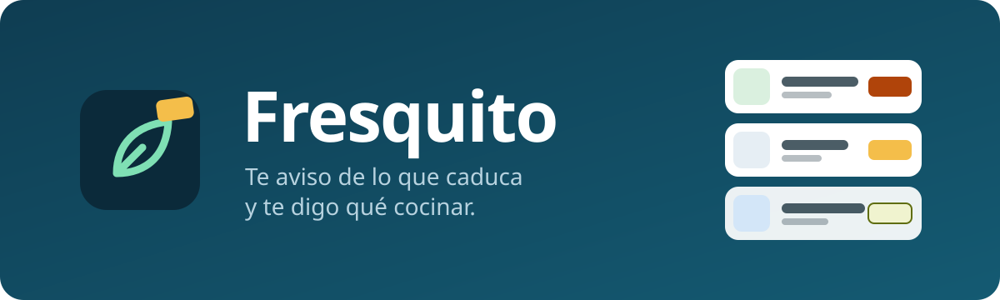

<h3 align="center">Lo que hay en tu nevera, antes de que caduque.</h3>

Apunta lo que compras con una foto del ticket o el código de barras. 
Te avisa de lo que se va a poner malo y te dice qué cocinar con ello. 
Gratis, sin registrarte y sin que nada tuyo se guarde en internet.

  

La demo se abre en el navegador, sin instalar nada. Trae comida de ejemplo y las respuestas «inteligentes»
son de muestra: toca lo que quieras, no se rompe ni se guarda nada tuyo.

---

## Índice

1. [Apuntar lo que compras](#1-apuntar-lo-que-compras)
2. [Qué caduca, a la vista](#2-qué-caduca-a-la-vista)
3. [¿Qué cocino hoy?](#3-qué-cocino-hoy)
4. [Tu plan de comidas](#4-tu-plan-de-comidas)
5. [La lista de la compra y el modo súper](#5-la-lista-de-la-compra-y-el-modo-súper)
6. [En familia](#6-en-familia)
7. [Ajustes y tu privacidad](#7-ajustes-y-tu-privacidad)
8. [Preguntas frecuentes](#8-preguntas-frecuentes)

---

## 1. Apuntar lo que compras

Hay cuatro formas: **1)** foto del ticket, **2)** código de barras, **3)** a mano y **4)** foto de la nevera (esta
última, solo con inteligencia artificial; ver el [apartado 7](#7-ajustes-y-tu-privacidad)). En todas revisas antes:
**nada entra en tu despensa hasta que pulsas «Añadir»**.

<table>
<tr>
<td width="50%" valign="top">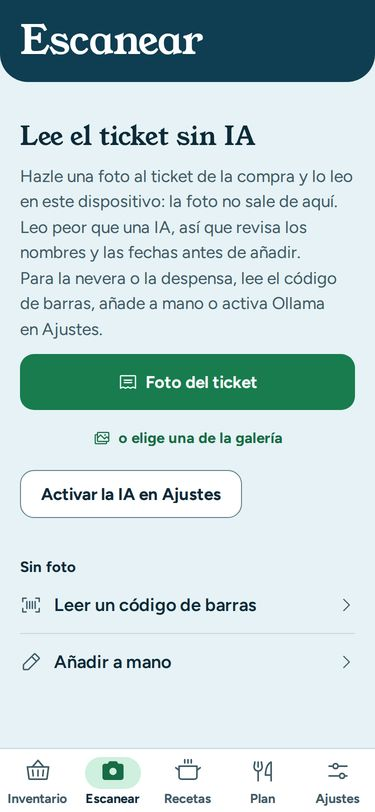 <b>📄 Foto del ticket.</b> Haz una foto recta y con buena luz. Fresquito la lee en tu propio móvil, sin enviarla a ningún sitio.</td>
<td width="50%" valign="top">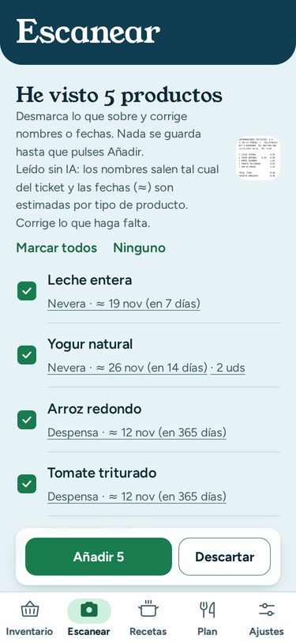 <b>✅ Revisa y añade.</b> Ves lo que ha leído, dónde lo guardará y hasta cuándo dura. Desmarca lo que sobre y pulsa «Añadir».</td>
</tr>
<tr>
<td width="50%" valign="top">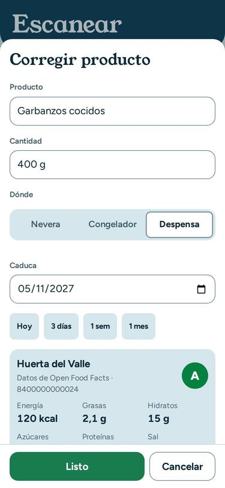 <b>🔢 Código de barras.</b> Apunta la cámara al código y Fresquito rellena solo el nombre, la marca y la nota nutricional (la letra de color, de la A a la E, que llevan muchos envases).</td>
<td width="50%" valign="top">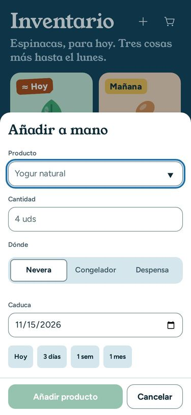 <b>✍️ A mano.</b> Escribe el nombre y Fresquito te sugiere dónde se guarda y cuánto suele durar.</td>
</tr>
</table>

- **¿Ya lo tenías?** Si compras algo que ya está en casa, te lo dice («Ya tienes 400 g en la nevera») y lo suma en vez
  de repetirlo.
- **¿Te has equivocado?** El aviso de «añadidos» trae el botón **Deshacer**.

> Las fechas con **≈** son estimadas según el tipo de producto. Si el envase dice otra cosa, tócala y cámbiala.

## 2. Qué caduca, a la vista

<table>
<tr>
<td width="50%" valign="top">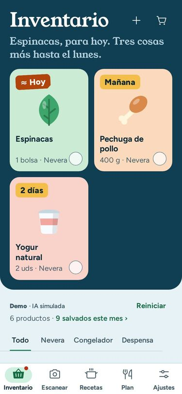</td>
<td width="50%" valign="top">

**Lo urgente, arriba y en grande.** Lo que caduca antes sale en fichas con su dibujo y una pegatina con el plazo:
«Hoy», «Mañana», «2 días»…

**Una frase te lo resume**, por ejemplo: «Espinacas, para hoy. Tres cosas más hasta el lunes».

**¿Lo has usado?** Toca el círculo y desaparece. Si te equivocas, **Deshacer**.

**Avisos en el móvil:** solo los días en que algo caduca pronto, a la hora que elijas.

</td>
</tr>
<tr>
<td width="50%" valign="top">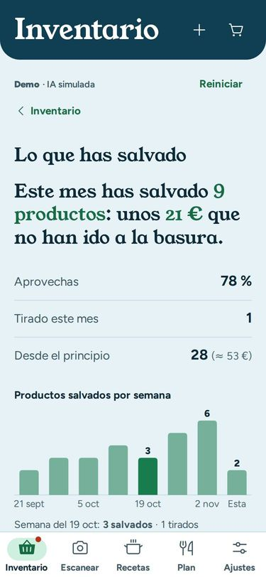</td>
<td width="50%" valign="top">

**Lo que has salvado:** cada mes ves cuánta comida has aprovechado en vez de tirarla.

</td>
</tr>
</table>

## 3. ¿Qué cocino hoy?

<table>
<tr>
<td width="50%" valign="top">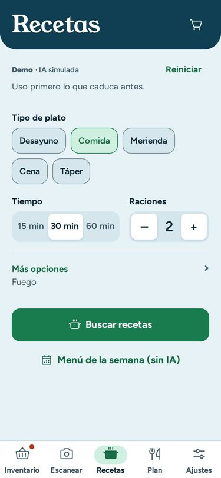 <b>Elige qué te apetece:</b> desayuno, comida, merienda, cena o táper; cuánto tiempo tienes y para cuántos.</td>
<td width="50%" valign="top">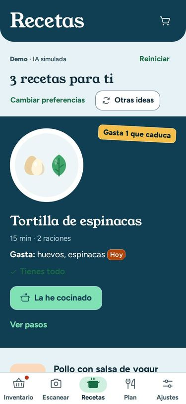 <b>Recetas que gastan primero lo que caduca.</b> Te dice qué usa de tu casa y qué te falta.</td>
</tr>
<tr>
<td width="50%" valign="top">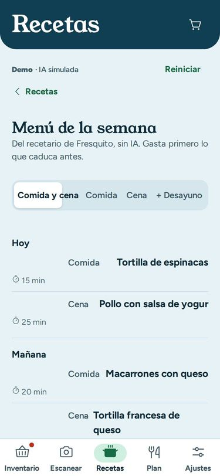 <b>Menú de la semana</b> pensado para no tirar nada; te apunta en la lista lo que falte.</td>
<td width="50%" valign="top">

- **Trae su propio recetario** de cocina casera; no necesitas nada más.
- **Vegana, sin gluten, sin lactosa, alta en proteína, picante…** en «Más opciones».
- **«La he cocinado»:** marca lo que has gastado (todo o una parte, por ejemplo 2 de tus 6 huevos) y, si sobra, se
  guarda como sobras con su fecha.
- **Alergias:** si en casa alguien evita un alimento, ninguna receta, menú ni plan lo llevará.

</td>
</tr>
</table>

## 4. Tu plan de comidas

<table>
<tr>
<td width="50%" valign="top">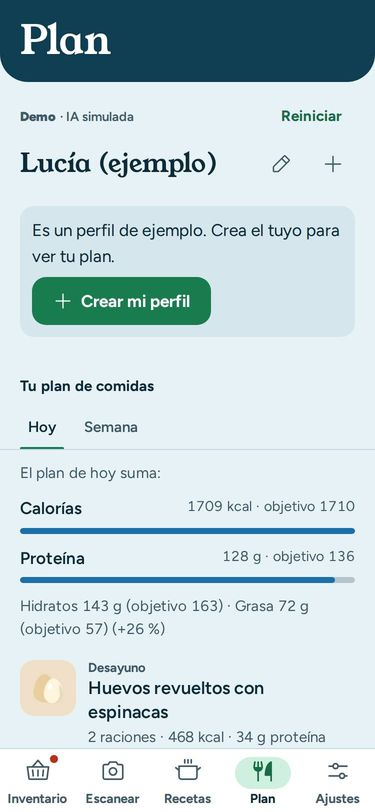</td>
<td width="50%" valign="top">

**Un plan para cada persona de casa.** Dices tu edad, altura, peso y lo que buscas (comer mejor, perder o ganar peso)
y Fresquito te propone las comidas del día **con lo que ya tienes**.

**Cuentas claras y prudentes:** «Gastas unas 1850 calorías al día; te propongo 1580». Nunca propone dietas peligrosas
ni bajar demasiado rápido.

**¿No te gusta algo?** Cámbialo por otra receta parecida o márcalo en «No me gusta».

**Para menores, embarazo o quien no quiera ver números**, el plan funciona igual pero sin cifras.

</td>
</tr>
</table>

> El plan es una orientación, **no sustituye a un médico o dietista**. Tus datos de salud se guardan protegidos en tu
> móvil y solo si das permiso.

## 5. La lista de la compra y el modo súper

<table>
<tr>
<td width="50%" valign="top">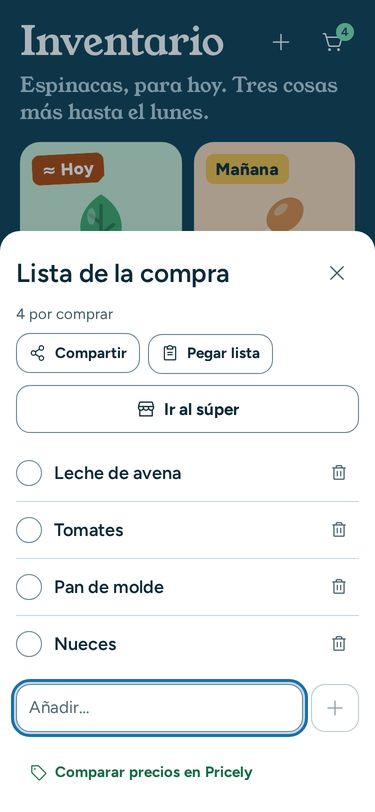 <b>La lista se llena sola</b> con lo que falta para tus recetas y tu plan. También puedes escribir o pegar una lista.</td>
<td width="50%" valign="top">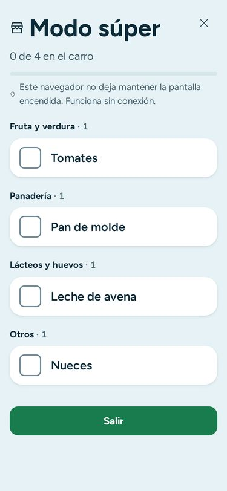 <b>Modo súper:</b> casillas grandes, ordenadas por secciones del súper, para usar con una mano en la tienda. Funciona sin internet.</td>
</tr>
</table>

- Si algo de la lista choca con las alergias de casa, la línea lo marca.
- **Comparar precios:** un toque te lleva a Pricely (una web que compara precios de supermercados) con cada producto.

## 6. En familia

**Cada móvil tiene su propia despensa; lo que se comparte es la lista de la compra.** Pulsa «Compartir» en la lista
y manda el enlace por WhatsApp. Quien lo abre ve qué ha cambiado y lo junta con su lista.

<table>
<tr>
<td width="50%" valign="top">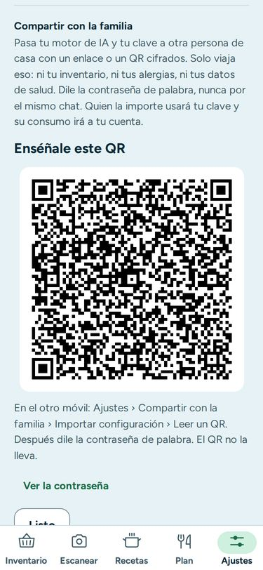</td>
<td width="50%" valign="top">

**Solo si usas inteligencia artificial:** para no configurarla dos veces, «Compartir con la familia» crea un código QR
(ese cuadrado de puntitos que se lee con la cámara). En el otro móvil, «Importar configuración» → «Leer un QR» y
escribes la contraseña, que se dice de palabra: nunca va dentro del QR. Solo pasa esa configuración, no la despensa.

**Varias personas en el plan:** cada una con su ficha, sus gustos y sus objetivos.

</td>
</tr>
</table>

## 7. Ajustes y tu privacidad

**Fresquito funciona sin inteligencia artificial:** ticket, código de barras, añadir a mano, recetario, menú y plan.

La inteligencia artificial (IA) es un programa que mira una foto y reconoce los alimentos, o que se inventa recetas
con lo que tienes. Es opcional. Si la quieres, en Ajustes tienes dos caminos:

- **Con tu propia cuenta** de un servicio de IA por internet (Google Gemini, Claude…). Cuesta céntimos al mes y la app
  te avisa de lo que se envía antes de cada uso.
- **Gratis y en casa, con Ollama** (para quien se anime: hace falta un ordenador encendido en casa y algo de maña).

<b>Cómo se ve Ollama en Ajustes</b>

 
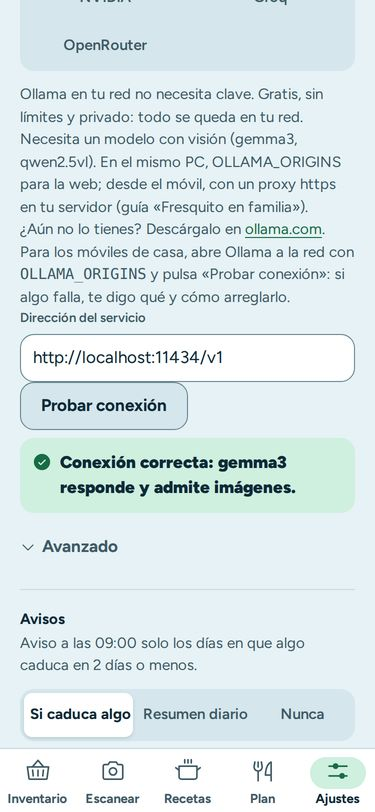

Ollama es un programa gratuito para el ordenador que hace de IA en casa: las fotos no salen de tu red. Lo instalas en
el ordenador, eliges «Ollama» en Ajustes y pulsas **«Probar conexión»**. Si algo falla, Fresquito te dice qué pasa y
cómo arreglarlo.

### Tu privacidad, en sencillo

- **Sin registrarte y sin que nada se guarde en internet.** Tu despensa, tu lista y tus gustos viven solo en tu móvil
  o en tu navegador.
- **La foto del ticket se lee en tu móvil.** Las fotos de la nevera solo salen si eliges un servicio de IA por
  internet, y solo hacia ese servicio.
- **Tus datos de salud se guardan protegidos con contraseña** y no salen de tu móvil sin tu permiso.
- **Del código de barras** solo viaja el número, para buscar el producto.
- Nada entra en tu despensa sin que lo confirmes.

## 8. Preguntas frecuentes

<b>¿Es gratis?</b>

Sí, del todo. Solo pagarías si decides usar un servicio de IA de pago con tu propia cuenta, y son céntimos al mes.

<b>¿Tengo que registrarme o dar mi correo?</b>

No. Ni cuenta, ni correo, ni contraseña.

<b>¿Cómo la instalo?</b>

La demo es para probar: trae comida de ejemplo y no guarda la tuya. Para usarla en casa, abre
[fresquito-demo.pages.dev](https://fresquito-demo.pages.dev/) en el móvil y, en el menú del navegador (los tres
puntitos), pulsa «Añadir a pantalla de inicio». Te queda un icono como cualquier otra app.

- **En el ordenador:** abre la app en Chrome o Edge y pulsa «Instalar» en la barra de direcciones.

<b>¿Funciona en iPhone?</b>

Sí, desde Safari: abre la app, pulsa el botón de compartir y «Añadir a pantalla de inicio». Te queda un icono como
cualquier otra app.

<b>¿Tengo que apuntar cada cosa que compro?</b>

No hace falta ir una a una: con la foto del ticket apuntas toda la compra en un minuto.

<b>¿Acierta siempre con las fechas?</b>

Si la fecha se lee en el envase, la usa. Si no, la estima según el producto y la marca con **≈**. Antes de añadir, y
después, puedes corregirla.

<b>¿Y si el ticket se lee mal?</b>

Es un borrador: revisa la lista antes de añadir y corrige o desmarca lo que no esté bien. Los tickets arrugados o con
poca luz se leen peor; una foto recta y con buena luz ayuda mucho.

<b>¿Mi pareja y yo vemos la misma despensa?</b>

No: cada móvil tiene la suya. Lo que sí podéis compartir es la lista de la compra (ver el [apartado 6](#6-en-familia)).

<b>¿Pierdo lo apuntado si cambio de móvil?</b>

No, si antes haces una copia: en Ajustes, «Copia de seguridad» → «Exportar copia» te da un archivo, y en el móvil
nuevo «Importar copia». Si borras los datos del navegador sin copia, se pierde.

<b>¿Quién ve mis fotos?</b>

Nadie. Las del ticket se leen en tu móvil. Las de la nevera solo salen si activas un servicio de IA por internet, y
solo hacia ese servicio para leerlas.

<b>¿Sirve si en casa hay alergias?</b>

Sí. En Ajustes, «Alergias e intolerancias en casa»: las recetas, el menú y el plan las evitan, y la lista de la compra
te avisa. Aun así, **mira siempre la etiqueta**: es una ayuda, no una garantía.

<b>¿Puedo usarla sin internet?</b>

Sí, para casi todo: la despensa, el recetario, el menú, el plan, la lista y el modo súper. Solo hace falta internet
para buscar un código de barras o si usas un servicio de IA por internet.

---

Hecho con cariño en España por Alberto Martínez · ¿Dudas o fallos? Escríbeme en [Issues](https://github.com/BertMarti/fresquito-demo/issues) (un buzón de sugerencias)
